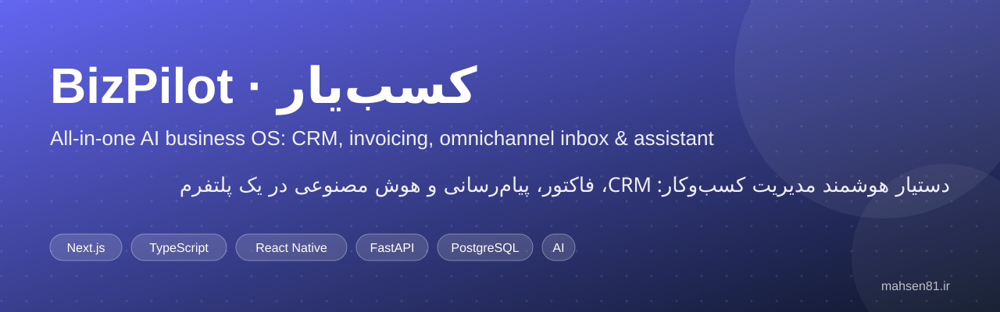
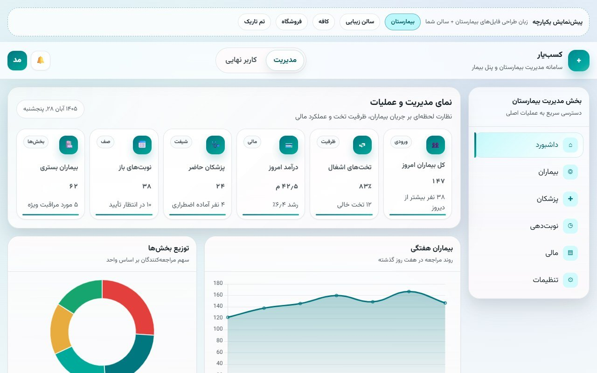
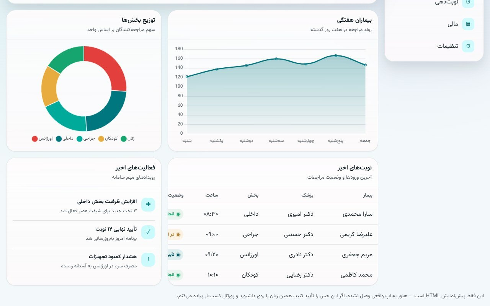
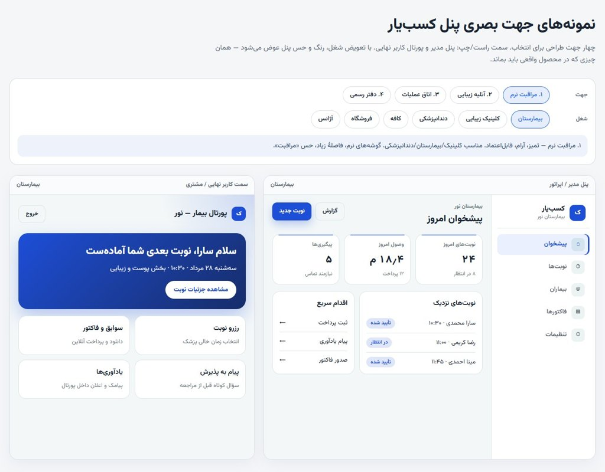
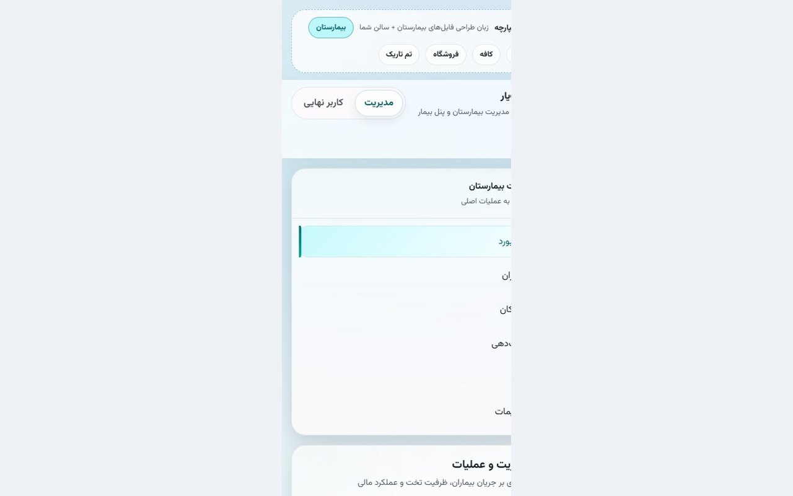

<!-- gen:header -->
<p align="center"></p>

<h1 align="center">BizPilot · کسب‌یار</h1>
<p align="center"><b>دستیار هوشمند مدیریت کسب‌وکار: CRM، فاکتور، پیام‌رسانی و هوش مصنوعی در یک پلتفرم</b><br><i>All-in-one AI business OS: CRM, invoicing, omnichannel inbox & assistant</i></p>
<p align="center">     </p>

> 💼 **این محصول آماده‌ی استقرار برای کسب‌وکار شماست.** نسخه‌ی اختصاصی با برند خودتان، راه‌اندازی روی سرور و پشتیبانی: [mahsen81.ir](https://mahsen81.ir)

<div dir="rtl">

## ✨ امکانات

- CRM کامل: سرنخ با کانبان، مشتری، وظایف و پیگیری
- فاکتور، پرداخت آنلاین و لینک پرداخت قابل اشتراک
- صندوق پیام یکپارچه (Omnichannel) با پاسخ از یک‌جا
- دستیار هوشمند و «اتاق فرمان» مبتنی بر هوش مصنوعی برای تحلیل اسناد و داده
- پک‌های تخصصی صنف‌ها، مثل آرایشگاه و کلینیک، با نوبت‌دهی و داشبورد نمودار
- اپ اندروید با کش آفلاین، اعلان Push و Deep Link


</div>

## 🎯 برای چه کسانی؟

- **کلینیک‌ها و بیمارستان‌ها**: نوبت‌دهی، پرونده‌ی بیمار و داشبورد مدیریت
- **سالن‌های زیبایی**: رزرو، یادآوری و پورتال مشتری
- **کافه، فروشگاه و آژانس‌ها**: فروش، فاکتور، مشتری و تیم
- **هر کسب‌وکار کوچک و متوسط** که می‌خواهد فروش، مشتری و تیمش را از یک‌جا مدیریت کند

## 🧩 معماری

| بخش | فناوری |
|---|---|
| وب‌اپ | Next.js، TypeScript و PostgreSQL، مستقر روی Vercel |
| اپ موبایل | React Native (Expo) با کش آفلاین و اعلان Push |
| سرویس هوش مصنوعی | FastAPI برای تحلیل PDF و DOCX و دستیار هوشمند |
| کیفیت | تست واحد، تست E2E و CI روی GitHub Actions |

## 📈 چرا کسب‌یار؟

- **یک پنل به‌جای ده ابزار**: CRM، فاکتور، پیام‌رسان، وظایف و گزارش
- **پک‌های صنفی آماده** با داشبورد و فرم‌های مخصوص هر صنف
- **هوش مصنوعی کاربردی** که از داده‌ی خود کسب‌وکار پیشنهاد می‌دهد
- **فارسی، شمسی و موبایل‌محور** از روز اول

## 📚 مستندات

[معماری](docs/ARCHITECTURE.md) · [API](docs/API.md) · [هوش مصنوعی](docs/AI_INTEGRATION.md) · [استقرار](docs/DEPLOYMENT.md) · [دمو](docs/DEMO.md) · [پشتیبان‌گیری](docs/BACKUP_RESTORE.md)

## 📸 تصاویر · Screenshots

<p align="center">    </p>

## 🚀 Quick start

```bash
npm install
copy apps\web\.env.example apps\web\.env   # DATABASE_URL, AI_SERVICE_TOKEN, ...
npm run dev            # web
npm run dev:mobile     # Android app (Expo)
```

---

<p align="center">ساخته‌شده توسط <a href="https://mahsen81.ir"><b>محسن جباره‌اصل</b></a> — برنامه‌نویسی، طراحی سایت، ربات و هوش مصنوعی<br>
Built by <a href="https://mahsen81.ir">Mohsen Jabbareh-Asl</a> · ⭐ اگر مفید بود، ستاره بدهید · Need a custom version? <a href="https://mahsen81.ir">Get in touch</a></p>
